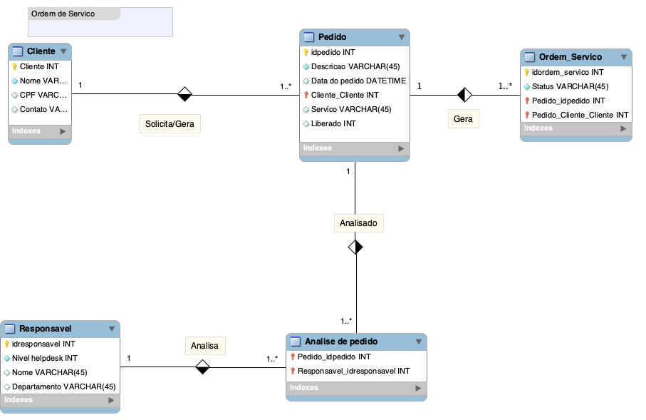
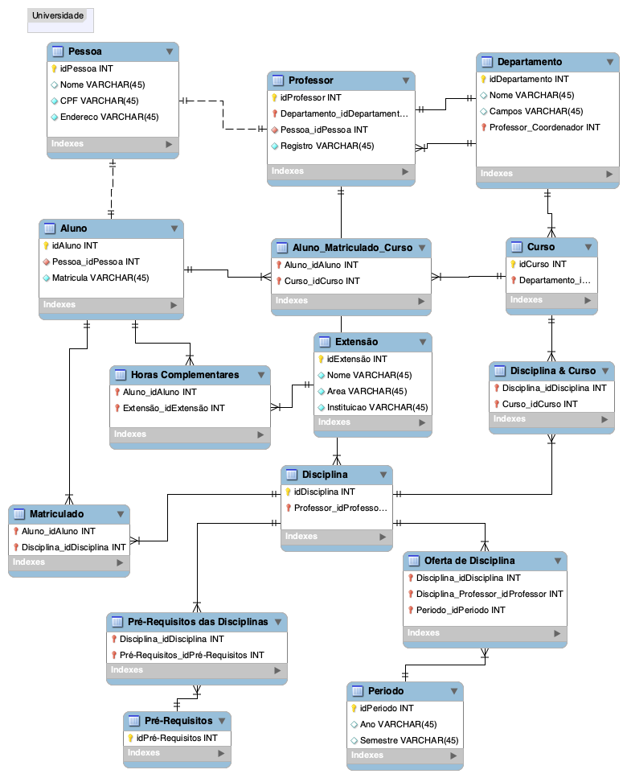
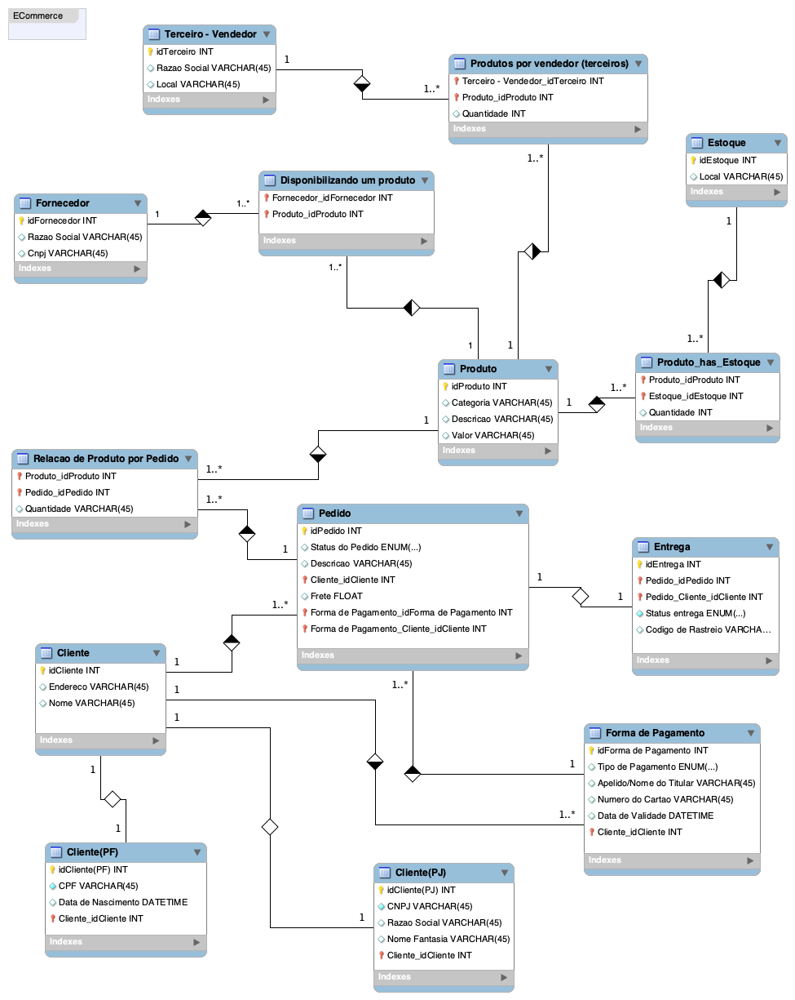
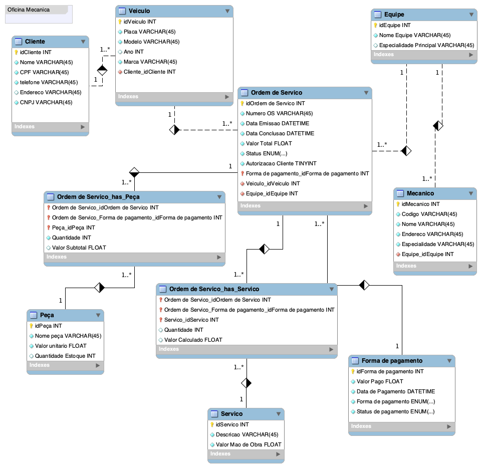

# Modelagem de Bancos de Dados Relacionais (MySQL)

Este repositório apresenta projetos práticos de modelagem de dados relacionais (Diagramas Entidade-Relacionamento Estendido — EER) desenvolvidos no **MySQL Workbench**. O objetivo é estruturar regras de negócio reais aplicando normalização, chaves primárias (`PK`), chaves estrangeiras (`FK`), cardinalidade e integridade referencial.

---

## 1. Fluxo Comercial e Operacional (Ordem de Serviço)

Modelagem voltada à rastreabilidade ponta a ponta de operações comerciais e atendimento, simulando a espinha dorsal de sistemas **CRM / ERP** e processos de **Sales & Service Operations**.

### Regras de Negócio e Arquitetura:
* **Cliente & Pedido (`1:N`):** Um cliente pode realizar múltiplos pedidos ao longo do tempo (`Cliente_Cliente`), registrando data, serviço solicitado e status de liberação.
* **Análise e Governança (`N:N` via `Analise de pedido`):** Resolve o relacionamento entre pedidos e responsáveis técnicos/helpdesk, permitindo auditar quem analisou cada solicitação antes da execução.
* **Geração de Ordem de Serviço (`1:N`):** Pedidos aprovados desdobram-se em uma ou mais Ordens de Serviço (`Ordem_Servico`) com controle de status operacional.

---

## 2. Sistema de Gestão Acadêmica (Universidade)

Modelagem de alta complexidade relacional contemplando herança/especialização de entidades, vínculos departamentais e grades curriculares.

### Regras de Negócio e Arquitetura:
* **Especialização de Entidades (`Pessoa` → `Aluno` / `Professor`):** Centraliza dados cadastrais comuns (Nome, CPF, Endereço) na tabela `Pessoa`, evitando redundância e garantindo integridade cadastral.
* **Estrutura Departamental e Cursos:** Relaciona `Departamento`, `Professor` (incluindo vínculo de coordenação) e `Curso`.
* **Relacionamentos Muitos-para-Muitos (`N:N`):** Estruturados por meio de tabelas associativas para controle de matrículas em cursos (`Aluno_Matriculado_Curso`), inscrições em disciplinas (`Matriculado`), atividades complementares (`Horas Complementares`), pré-requisitos (`Pré-Requisitos das Disciplinas`) e alocação de docentes por semestre (`Oferta de Disciplina`).

---

## 3. Plataforma de E-commerce (Refinamento de Modelo Conceitual)

Modelagem conceitual e lógica de um sistema de vendas online, evoluída a partir de um esquema base para atender a regras de negócio de varejo digital, meios de pagamento e logística.

### Regras de Negócio e Arquitetura:
* **Especialização de Clientes (`Cliente` → `Cliente(PF)` / `Cliente(PJ)`):** Separa cadastros de Pessoa Física (`CPF`) e Pessoa Jurídica (`CNPJ`, `Razao Social`, `Nome Fantasia`) em relacionamentos `1:1` exclusivos, evitando campos nulos e garantindo unicidade fiscal.
* **Múltiplas Formas de Pagamento (`Forma de Pagamento`):** Permite que um cliente cadastre diversos meios de pagamento (`ENUM`: Cartão de Crédito, Débito, PIX, Boleto) e os reutilize em diferentes pedidos (`1:N`), omitindo o CVV em conformidade com boas práticas de segurança.
* **Desacoplamento Logístico (`Entrega`):** Separa o fluxo de entrega (`Status entrega` via `ENUM` e `Codigo de Rastreio`) da aprovação comercial do `Pedido` (`1:1`), eliminando redundâncias e preservando o histórico logístico mesmo em cenários de cancelamento.
* **Cadeia de Suprimentos e Marketplace (`N:M`):** Integra `Produto` com `Fornecedor`, `Estoque` e `Terceiro - Vendedor` por meio de tabelas associativas para controle de disponibilidade e inventário.
---

## 4. Sistema de Gestão de Oficina Mecânica (Ordem de Serviço)

Modelagem conceitual e lógica desenvolvida do zero para controle de atendimentos, equipes de mecânicos, catálogo de serviços e peças de uma oficina mecânica.

### Regras de Negócio e Arquitetura:
* **Clientes e Veículos (`1:N`):** Permite o cadastro de clientes (PF/PJ) associados a múltiplos veículos (`Veiculo`), mantendo o histórico individualizado de cada automóvel pela placa e modelo.
* **Equipes e Mecânicos (`1:N`):** Organiza os profissionais (`Mecanico`, com código, endereço e especialidade) em equipes responsáveis tanto pela avaliação técnica quanto pela execução dos reparos.
* **Ordem de Serviço e Autorização (`Ordem de Servico`):** Centraliza número da OS, datas de emissão e conclusão, valor total, flag de autorização do cliente (`Autorizacao Cliente`) e status operacional controlado via `ENUM`.
* **Composição de Serviços e Peças (`N:M`):** Utiliza tabelas associativas (`Ordem de Servico_has_Servico` e `Ordem de Servico_has_Peça`) para registrar quantidades, valores unitários e subtotais calculados a partir das tabelas de referência de mão de obra e estoque de peças.
* **Controle Financeiro (`Forma de pagamento`):** Vincula o método de pagamento (`ENUM`: PIX, Cartão, Dinheiro, Boleto) e o status de quitação diretamente à Ordem de Serviço.

---

## Tecnologias e Conceitos Aplicados

* **Ferramentas:** MySQL Workbench, SQL (DDL / DML)
* **Conceitos:** Modelagem Conceitual e Lógica (DER/EER), Normalização (1FN, 2FN, 3FN), Integridade Referencial e Cardinalidade.
